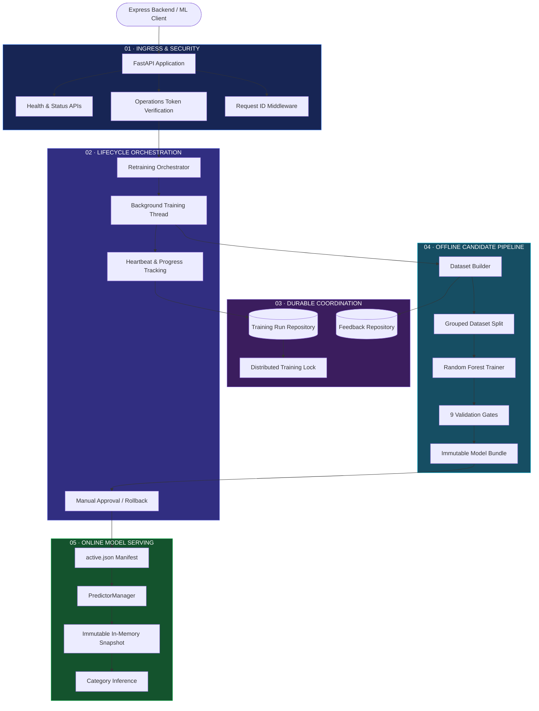
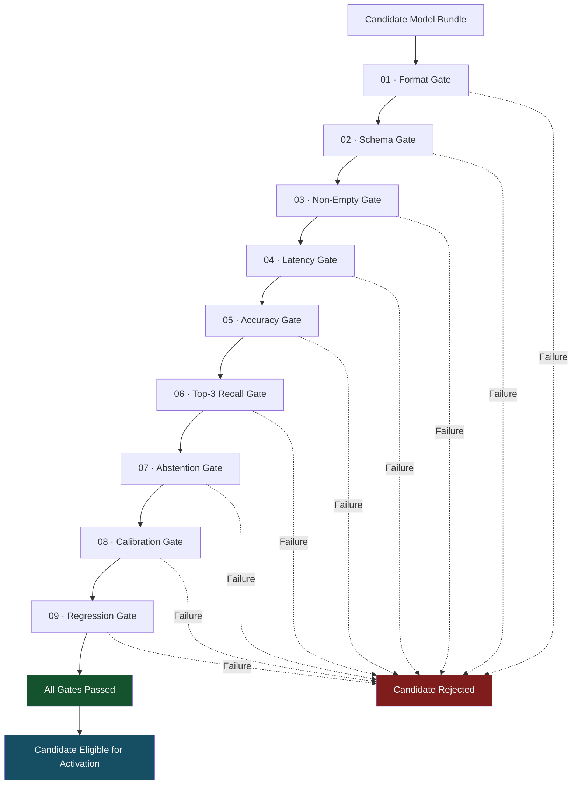
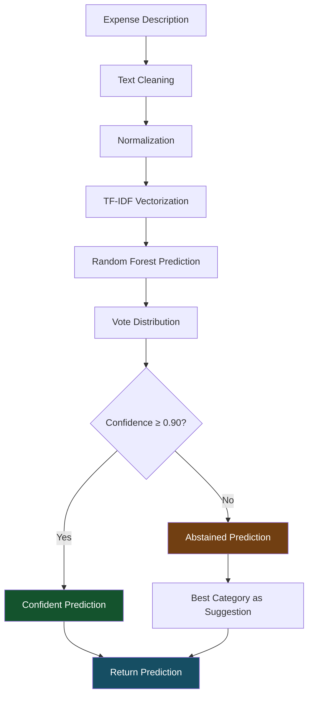
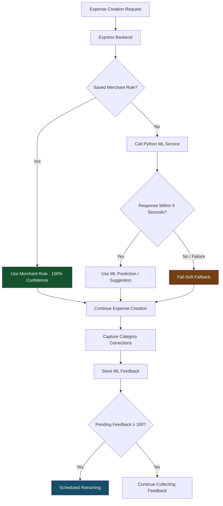
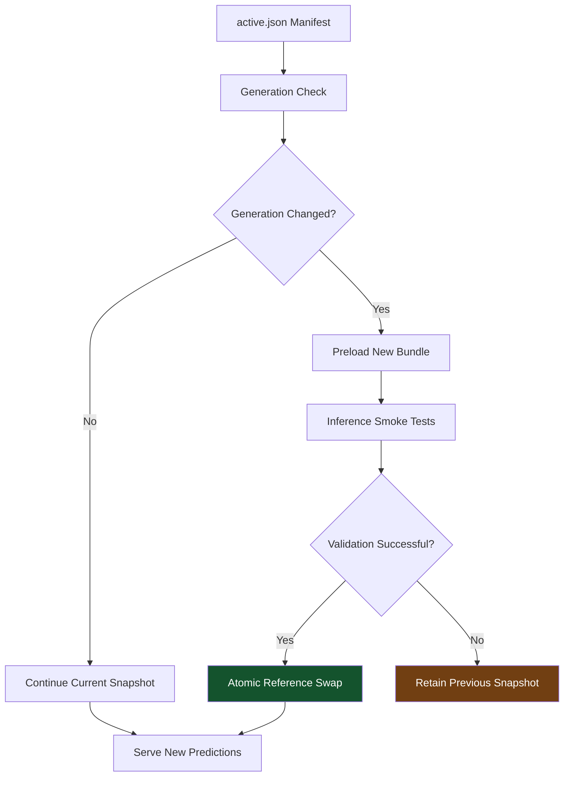
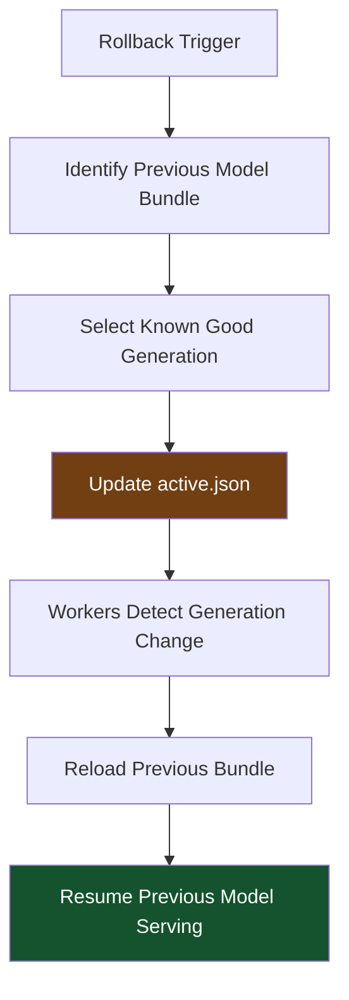

# BALENSIA — ML Service Architecture

<p align="center">
  
  <br /><br />
  <strong>A Visual Journey Through the Machine Learning Engineering Behind BALENSIA</strong>
  <br />
  <sub>Interactive architecture visualization · Intelligent inference · Model lifecycle management · Automated validation</sub>
  <br /><br />
  <a href="https://github.com/nareshjo001/expense-manager">
    
  </a>
  
  
  
  
  <br />
  
  
  
</p>

---

## ◈ About This Project

The BALENSIA ML Service is an asynchronous Python microservice responsible for intelligent expense categorization, confidence-based prediction abstention, deterministic description generation, and automated machine learning model lifecycle management.

Built using **FastAPI, Scikit-Learn, and PyMongo**, the service combines real-time inference with a controlled offline retraining pipeline.

Its architecture is designed around an important principle:

**A newly trained model should never become active until it has passed every required quality and regression check.**

The **BALENSIA ML Service Architecture Visualizer** transforms this system into an interactive engineering map, illustrating how inference, feedback collection, model training, validation, activation, and rollback work together.

> **Architecture audit:** Maintained against the latest available state of the [BALENSIA repository](https://github.com/nareshjo001/expense-manager) on the `main` branch.

---

## ◈ At a Glance

<table>
<tr>
<td align="center" width="33%">
<h2>12</h2>
<strong>Route Operations</strong>
<br /><sub>8 protected · 4 open probes</sub>
</td>
<td align="center" width="33%">
<h2>9</h2>
<strong>Validation Gates</strong>
<br /><sub>Sequential model verification</sub>
</td>
<td align="center" width="33%">
<h2>179</h2>
<strong>Test Functions</strong>
<br /><sub>Across 19 test files</sub>
</td>
</tr>
<tr>
<td align="center">
<h2>5 sec</h2>
<strong>Reload Interval</strong>
<br /><sub>Throttled manifest checks</sub>
</td>
<td align="center">
<h2>97,056</h2>
<strong>Base Dataset Rows</strong>
<br /><sub>Static training data</sub>
</td>
<td align="center">
<h2>0.90</h2>
<strong>Confidence Threshold</strong>
<br /><sub>Prediction abstention policy</sub>
</td>
</tr>
</table>

<sub>Test breakdown: 153 passed unit/contract/failure-injection tests, 2 skipped, with additional integration and process-level tests.</sub>

---

## ◈ Explore the Architecture

| Section | What You'll Discover |
|:---|:---|
| [01 — System Architecture](#01--system-architecture) | Five-layer ML service architecture |
| [02 — Technology Stack](#02--technology-stack) | ML infrastructure and technologies |
| [03 — Model Validation](#03--the-nine-model-validation-gates) | Nine sequential model quality gates |
| [04 — Core Workflows](#04--core-end-to-end-workflows) | Inference, feedback, training, and rollback |
| [05 — Security & Boundaries](#05--security--architectural-boundaries) | Immutable serving and operational guarantees |
| [06 — Limitations & Improvements](#06--active-limitations--resolved-improvements) | Current limitations and engineering improvements |
| [07 — Run Locally](#07--run-the-visualizer-locally) | Launching the architecture visualizer |
| [08 — Deployment](#08--github-pages-deployment) | Static hosting and publishing |

---

# 01 — System Architecture

## The Five-Layer Architecture

The BALENSIA ML service is organized into five layers, separating API security, lifecycle orchestration, durable coordination, offline model development, and online inference.



### Layer 01 — Ingress & Security Boundary

<sub>`app.py` · `status_api.py`</sub>

Controls incoming requests, authentication, request validation, and service health monitoring.

- 12 route operations.
- Pydantic request validation.
- `X-ML-Operations-Token` authentication.
- Fail-closed security through `verify_operations_token()`.
- `X-Request-ID` propagation.
- Liveness and readiness probes.

**Route security distribution**

| Route Category | Count | Access |
|:---|:---:|:---|
| Protected operations | 8 | Operations token required |
| Health and status probes | 4 | Open |
| **Total** | **12** | |

**Open probes**

- `HEAD /`
- `GET /`
- `GET /health/live`
- `GET /health/ready`

**Fail-closed authentication behavior**

| Condition | Response |
|:---|:---|
| Operations token not configured | HTTP 503 |
| Invalid operations token | HTTP 401 |
| Valid operations token | Request proceeds |

### Layer 02 — Lifecycle Control & Orchestration

<sub>`app.py` · `training/retrain_pipeline.py`</sub>

Coordinates the machine learning model lifecycle without blocking normal inference requests.

- Non-blocking background retraining thread.
- Training lifecycle management.
- Heartbeat-based progress tracking.
- Manual approval support.
- Automatic rollback on failure.
- Startup reconciliation.

**Training lifecycle timestamps**

| Field | Purpose |
|:---|:---|
| `createdAt` | Training run creation |
| `startedAt` | Training execution start |
| `heartbeatAt` | Latest progress update |
| `completedAt` | Training completion |

**Human approval control**

The `ML_REQUIRE_MANUAL_APPROVAL` setting can pause model activation until a human approves the candidate.

### Layer 03 — Durable Coordination & Repositories

<sub>`db/mongo.py` · `db/`</sub>

Manages persistent training state, feedback reservations, and distributed coordination.

**Training Run Repository**

`training_run_repository.py`

- Training state machine transitions.
- Singleton distributed retraining lock.
- Atomic training-run claims.
- Persistent lifecycle tracking.
- Recovery from interrupted execution.

**Feedback Repository**

`feedback_repository.py`

- User category correction storage.
- Atomic feedback reservation.
- Feedback status lifecycle.
- Training dataset integration.

**MongoDB collections**

- `mltrainingruns`
- `mlfeedback`

### Layer 04 — Offline Candidate Pipeline

<sub>`training/`</sub>

Responsible for constructing datasets, training candidate models, and verifying model quality before activation.

**Core components**

| Component | Responsibility |
|:---|:---|
| `dataset_builder.py` | Creates immutable per-run training snapshots |
| `grouped_split.py` | Creates grouped train/validation/test datasets |
| `trainer.py` | Trains Random Forest models in isolated subprocesses |
| `validate_model.py` | Executes nine sequential quality gates |
| `rollback_model.py` | Restores a previous model generation |

**Dataset characteristics**

- Static base dataset: 97,056 rows.
- User feedback incorporated into training snapshots.
- Immutable per-run dataset generation.
- Grouped dataset splitting to prevent identical descriptions from leaking across folds.

### Layer 05 — Online Serving & Runtime Snapshot

<sub>`inference/predictor_manager.py`</sub>

Provides real-time expense categorization through an immutable in-memory model snapshot.

**Core components**

- `active.json` selects the active model bundle.
- `PredictorManager` manages the serving model.
- Manifest generation is checked every five seconds, subject to throttling.
- New bundles are preloaded and checked through inference smoke tests.
- Model references are swapped atomically.
- Legacy model bundle fallback supports fresh installations.

**Serving principle**

Each worker serves predictions from its in-memory snapshot without querying MongoDB for every inference request.

---

# 02 — Technology Stack

The machine learning infrastructure powering BALENSIA.

| Category | Technologies |
|:---|:---|
| Language | Python |
| Web Framework | FastAPI |
| Request Validation | Pydantic |
| Machine Learning | Scikit-Learn |
| Classification Algorithm | Random Forest |
| Text Representation | TF-IDF |
| Model Serialization | Joblib |
| Database | MongoDB |
| Database Integration | PyMongo |
| Model Coordination | MongoDB repositories |
| Model Serving | PredictorManager |
| Testing | Pytest / Python test suite |
| API Communication | REST APIs |

---

# 03 — The Nine Model Validation Gates

## Candidate Model Quality Assurance

One of the most important architectural features of BALENSIA is its nine-stage model validation pipeline.

A candidate model cannot be published or activated until it passes all required validation gates.



## Validation Gate Breakdown

| # | Validation Gate | What It Verifies |
|:---:|:---|:---|
| 01 | Format Gate | Required model artifacts exist |
| 02 | Schema Gate | Metadata matches versioned schema and category taxonomy |
| 03 | Non-Empty Gate | Evaluation datasets contain positive samples for all classes |
| 04 | Latency Gate | Single-prediction latency remains within budget |
| 05 | Accuracy Gate | Validation accuracy exceeds the minimum threshold |
| 06 | Top-K Recall Gate | Top-3 category recall meets quality requirements |
| 07 | Abstention Gate | Confidence-based abstention works for edge cases |
| 08 | Calibration Gate | Predicted probabilities align with empirical accuracy |
| 09 | Regression Gate | Candidate does not exceed the allowed accuracy regression |

### Gate 01 — Format

Checks that the candidate bundle contains all required artifacts:

```text
vectorizer.joblib
model.joblib
label_encoder.joblib
metadata.json
```

### Gate 02 — Schema

Validates the versioned metadata schema and category taxonomy.

### Gate 03 — Non-Empty Dataset

Ensures the evaluation datasets contain positive samples for all required classes.

### Gate 04 — Inference Latency

Verifies that individual prediction requests satisfy the configured maximum latency budget.

### Gate 05 — Accuracy

Ensures validation accuracy exceeds the absolute minimum performance threshold.

### Gate 06 — Top-3 Recall

Measures whether the correct expense category appears among the model's top three predictions.

### Gate 07 — Abstention

Verifies that the confidence-based abstention policy correctly handles uncertain and edge-case inputs.

### Gate 08 — Calibration

Evaluates whether predicted probabilities align with observed classification accuracy across confidence bins.

### Gate 09 — Regression

Compares candidate performance against the active model.

The candidate must remain within the configured regression limit:

```python
ML_MAX_ACCURACY_REGRESSION
```

---

# 04 — Core End-to-End Workflows

Four major workflows demonstrate how the ML service handles inference, backend integration, multi-worker model serving, and recovery.

## 4.1 Online Expense Category Inference

<sub>Endpoint: `POST /predict-category`</sub>

The inference pipeline receives expense description text and predicts the most likely financial category.



**Processing stages**

1. Text cleaning and normalization.
2. Case folding.
3. Whitespace trimming.
4. Punctuation stripping.
5. TF-IDF vectorization.
6. Random Forest prediction.
7. Confidence distribution calculation.
8. Abstention policy evaluation.

**Confidence-based abstention**

The global confidence threshold is `0.90`.

| Prediction Condition | Result |
|:---|:---|
| Confidence ≥ 0.90 | Confident prediction |
| Confidence below 0.90 | `abstained: true` |
| Low confidence | `reason: low_confidence` |

Even when the prediction is abstained, the service returns the best category as a suggestion.

## 4.2 Express Backend Integration

The Express backend acts as the primary application service and communicates with the Python ML microservice when machine learning assistance is required.



**Integration characteristics**

- Saved `MerchantRule` records are checked first.
- Merchant rules take priority with 100% confidence.
- ML prediction uses a five-second fail-soft timeout.
- Prediction failures do not disrupt expense creation.
- User category corrections are captured as ML feedback.
- Retraining is triggered at 20:30 when pending corrections reach 100 or more.

## 4.3 Multi-Worker Lazy Model Reload

<sub>`inference/predictor_manager.py`</sub>

BALENSIA supports multiple serving workers without requiring a database query for every prediction.



**Reload mechanism**

- Each worker holds an immutable in-memory predictor snapshot.
- Workers periodically check the `active.json` manifest.
- Manifest checks are throttled to five seconds.
- New bundles are preloaded before activation.
- Inference smoke tests run before the swap.
- Successful reloads atomically replace the predictor reference.
- Failed reloads retain the previous snapshot.

**Key benefit:** Existing prediction requests continue using a valid model while a new model is being prepared.

## 4.4 Break-Glass Model Rollback

<sub>`training/rollback_model.py`</sub>

The rollback mechanism provides a recovery path when an active model needs to be reverted.



**Rollback capabilities**

- CLI-based rollback.
- Programmatic rollback.
- Previous model generation selection.
- Active manifest restoration.
- Multi-worker reload through manifest generation checks.

---

# 05 — Security & Architectural Boundaries

The ML service follows strict operational boundaries to protect model artifacts, coordinate retraining, and prevent unreliable predictions from being served as confident classifications.

## 5.1 Guaranteed Capabilities

| Area | Implementation |
|:---|:---|
| Model immutability | Serving bundles are immutable |
| Training isolation | Retraining writes separate per-run bundles |
| Operations security | Fail-closed token verification |
| Crash recovery | Startup reconciliation |
| Feedback integrity | Atomic reservation and status management |
| Inference safety | Confidence-based abstention |
| Model activation | Nine sequential validation gates |
| Multi-worker serving | Atomic predictor snapshot replacement |

### Immutable Model Serving

Live serving artifacts are never modified in place during retraining.

New model candidates are written to isolated per-run directories and only become eligible for activation after validation.

### Fail-Closed Operations Security

Eight of the twelve route operations require a valid `X-ML-Operations-Token`.

- Missing or unconfigured token: HTTP 503.
- Invalid token: HTTP 401.
- Valid token: Authorized operation.

### Startup Reconciliation

Startup reconciliation repairs interrupted lifecycle operations and orphaned feedback reservations where supported by the recovery logic.

### Confidence-Based Abstention

Low-confidence predictions are explicitly marked as abstained rather than presented as reliable classifications.

## 5.2 Architectural Non-Goals

| Non-Goal | Architectural Decision |
|:---|:---|
| LLM-based descriptions | Uses deterministic keyword rules and category templates |
| Financial spending forecasting | Handled by the backend statistical analyzer |
| User financial account access | ML service operates on anonymized text strings and category labels |
| In-place model retraining | Uses isolated immutable candidate bundles |

## 5.3 Operational Boundaries

| Component | Responsibility |
|:---|:---|
| Express backend | Expense operations and feedback collection |
| FastAPI ML service | Category inference and model lifecycle |
| MongoDB | Training runs and feedback coordination |
| Model storage | Immutable model bundles and active manifest |
| PredictorManager | In-memory model snapshots |
| Rollback utility | Recovery to a previous model generation |

---

# 06 — Active Limitations & Resolved Improvements

## Active Limitations

| Component | Current Limitation |
|:---|:---|
| Feedback reservations | Rejecting a candidate does not currently un-reserve its associated feedback rows |
| Manual approval | Approval endpoint activates without acquiring the global training lock |
| Multi-worker deployment | Requires shared `/data/models` storage for synchronized model artifacts |

## Recently Resolved Improvements

<details>
<summary><strong>01 · Streamlined Source Files</strong></summary>

Removed 3,048 lines of dead code and verbose legacy comments across 24 source files, improving maintainability and reducing unnecessary implementation complexity.

</details>

<details>
<summary><strong>02 · Multi-Worker Atomic Reload</strong></summary>

Introduced throttled five-second manifest checks, immutable predictor snapshots, and lock-free atomic reference swaps.

</details>

<details>
<summary><strong>03 · Idempotent Training Run Claims</strong></summary>

Implemented atomic `findOneAndUpdate` operations and a unique index to prevent concurrent conflicting retraining claims.

</details>

<details>
<summary><strong>04 · Theme-Adaptive Scrollbars</strong></summary>

Introduced custom 6px rounded scrollbars that adapt to the application's dark and light color tokens.

</details>

---

# 07 — Run the Visualizer Locally

The ML service architecture visualizer is a standalone static application.

**No npm installation. No build process. No third-party dependencies.**

### Option 1 — Open Directly

Open `index.html` in any modern browser.

### Option 2 — Python HTTP Server

Navigate to the visualizer directory and execute:

```bash
python -m http.server 8080
```

Open the following address:

```text
http://localhost:8080
```

---

# 08 — GitHub Pages Deployment

The visualizer supports static hosting through GitHub Pages.

**Deployment features**

- Relative asset paths.
- Zero external CDN dependencies.
- Zero third-party runtime dependencies.
- GitHub Actions workflow.
- Automated publishing through `.github/workflows/pages.yml`.

Configure GitHub Pages to use the repository's GitHub Actions workflow to enable publishing.

---

# 09 — Technical Standards

## Engineering Standards

| Category | Standard |
|:---|:---|
| Language | Python |
| ML Framework | Scikit-Learn |
| Service Framework | FastAPI |
| Markup | HTML5 |
| Styling | CSS3 |
| Visualizer Scripting | Vanilla JavaScript (ES2022) |
| External Visualizer Dependencies | Zero |
| Build Tools for Visualizer | None |
| Hosting | GitHub Pages compatible |
| Responsive Support | Desktop, tablet, and mobile |
| Accessibility | Semantic structure and reduced-motion support |

## Visualizer Design Language

The visualizer follows the BALENSIA design language.

- Consistent 4px vertical accent-line heading pattern.
- Accent dimensions: `4px × 24px`.
- Structured typography and spacing.
- Dark and light themes.
- Responsive layouts.
- Accessible interactions.
- `prefers-reduced-motion` support.

---

## ◈ ML Architecture at a Glance

| Architectural Area | Responsibility | Core Technology |
|:---|:---|:---|
| 01 · Ingress | API security and request validation | FastAPI, Pydantic |
| 02 · Orchestration | Training lifecycle and approvals | Python |
| 03 · Coordination | Training runs and feedback reservations | MongoDB, PyMongo |
| 04 · Model Development | Dataset preparation, training, validation | Scikit-Learn |
| 05 · Model Serving | Immutable snapshots and inference | PredictorManager |

---

<p align="center">
  <br />
  <strong>BUILT FOR INTELLIGENCE. ENGINEERED FOR TRUST.</strong>
  <br />
  <sub>Designed to document. Built to explore. Engineered for clarity.</sub>
  <br /><br />
  <a href="https://github.com/nareshjo001/expense-manager">
    <strong>Explore the BALENSIA Repository →</strong>
  </a>
  <br /><br />
  <sub>© BALENSIA · ML Service Architecture Documentation</sub>
</p>